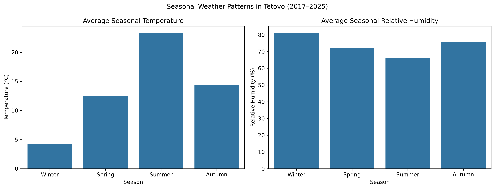
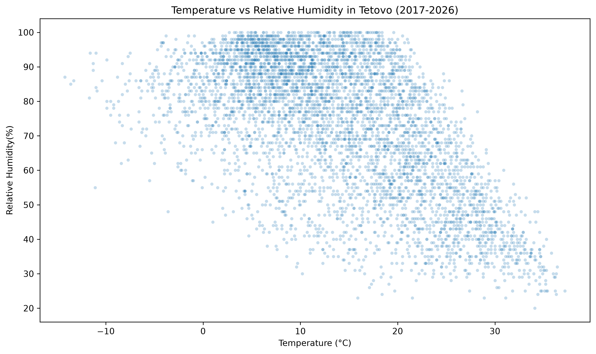

# Tetovo Air Quality Forecasting

This is a university IoT project focused on analyzing and predicting air pollution (PM2.5) in Tetovo, North Macedonia.

We are using historical air quality and weather data to understand pollution patterns. Later, we plan to use machine learning and connect the system with IoT sensors for PM2.5, temperature, and humidity.

## Work Done So Far

- Collected historical weather and air pollution datasets (2017–2026).
- Completed EDA on temperature and humidity using Python.
- Analyzed hourly and seasonal weather patterns.
- Found a negative correlation between temperature and humidity (r = -0.596).

## Weather EDA

The weather analysis was done using ERA5 data from Open-Meteo.

### Seasonal Temperature and Humidity

### Temperature and Humidity Correlation

[View Weather EDA Notebook](notebooks/weather/01_weather_eda.ipynb)

## Tools Used

Python, Pandas, NumPy, Matplotlib, Seaborn, Jupyter Notebook, Git and GitHub.

## What's Next?

- Air pollution EDA (PM2.5)
- Combine weather and pollution datasets
- Train machine learning models
- Connect IoT sensors
- Build a simple dashboard

## Data Sources

- Weather: [Open-Meteo](https://open-meteo.com/) (ERA5)
- Air Pollution: North Macedonia's official air quality monitoring data

*This project is still in progress.*